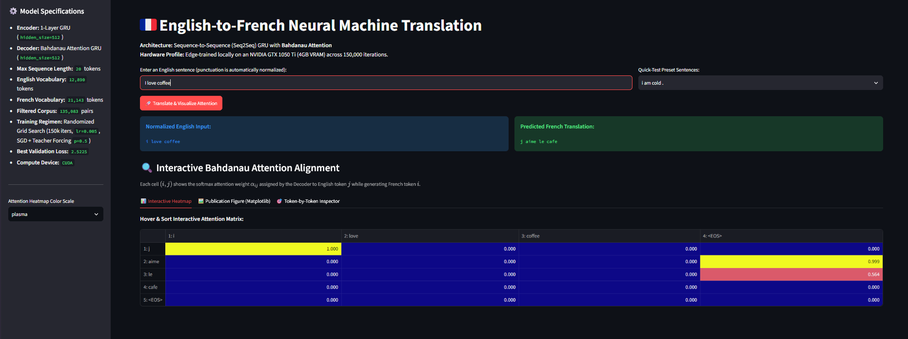
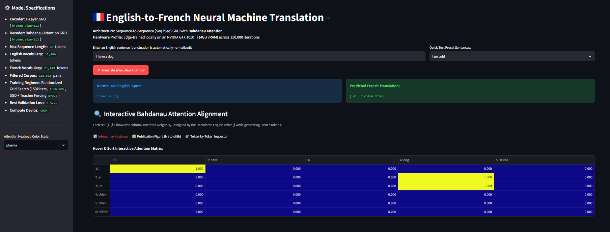

# 🇫🇷 English-to-French Neural Machine Translation (Seq2Seq + Bahdanau Attention)

An end-to-end Neural Machine Translation (NMT) system built from scratch in **PyTorch**, featuring a Gated Recurrent Unit (GRU) Encoder-Decoder architecture augmented with **Bahdanau (Additive) Attention**. 

Designed and trained under local edge-computing constraints (NVIDIA GTX 1050 Ti, 4GB VRAM), this project explores the mechanics of recurrent sequence alignment, teacher forcing, hyperparameter grid search, and real-time attention weight introspection via an interactive **Streamlit** web application.

---

## 📌 Key Highlights & Technical Specifications

* **Architecture:** 1-Layer GRU Encoder + Bahdanau Attention GRU Decoder (`hidden_size = 512`, `dropout = 0.1`)
* **Dataset:** Tatoeba English-French Parallel Corpus (`135,842` raw pairs $\rightarrow$ `135,083` filtered pairs at `MAX_LENGTH = 20`)
* **Vocabulary Space:** `12,890` English tokens | `21,143` French tokens
* **Training Regimen:** Randomized Grid Search across $H \in \{128, 256, 512\}$ and $\eta \in \{0.01, 0.005, 0.001\}$ for `150,000` iterations (~1.1 epochs) using Stochastic Gradient Descent (SGD), Negative Log-Likelihood Loss (`NLLLoss`), and Teacher Forcing ($p = 0.5$)
* **Best Validation Loss:** `2.5225` (`modelV2` with Attention) vs. `3.9734` (`model` baseline without Attention)
* **Hardware Profile:** Edge-trained locally on an NVIDIA GeForce GTX 1050 Ti (CUDA)

---

## 🧠 Architectural Evolution & Mathematical Formulation

### 1. Baseline Seq2Seq (`model/`)
In the vanilla Encoder-Decoder architecture (`Machine_Translation_Seq2Seq_GRU.ipynb`), the Encoder compresses the entire source sequence $\mathbf{x} = (x_1, \dots, x_T)$ into a single fixed-size final hidden state $\mathbf{h}_T$. This creates an **information bottleneck**, causing the decoder to lose context over longer sequences.

### 2. Bahdanau Attention Mechanism (`modelV2/`)
To resolve the bottleneck (`Machine_translation_Seq2seq_with_Attention.ipynb`), the Encoder outputs at every timestep $\mathbf{H} = (\mathbf{h}_1, \dots, \mathbf{h}_{T_x})$ are retained. At each decoding step $t$, the `AttnDecoderRNN` computes a dynamic softmax alignment distribution $\boldsymbol{\alpha}_t$ over the source sequence using the current embedded input $\mathbf{e}_t$ and previous decoder hidden state $\mathbf{s}_{t-1}$:

$$\boldsymbol{\alpha}_t = \text{softmax}\left(\mathbf{W}_a [\mathbf{e}_t ; \mathbf{s}_{t-1}] + \mathbf{b}_a\right)$$

The resulting attention weights are multiplied via batch matrix multiplication (`torch.bmm`) against the encoder outputs to form a focused context vector $\mathbf{c}_t$:

$$\mathbf{c}_t = \sum_{j=1}^{T_x} \alpha_{t,j} \mathbf{h}_j$$

The context vector $\mathbf{c}_t$ and embedded token $\mathbf{e}_t$ are concatenated, projected through a linear combination layer (`attn_combine`) with $\text{ReLU}$ activation, and passed into the Decoder GRU to predict the log-softmax probability distribution over the 21,143-word French vocabulary:

$$P(y_t \mid y_{<t}, \mathbf{x}) = \text{log\_softmax}(\mathbf{W}_o \mathbf{s}_t + \mathbf{b}_o)$$

---

## 🔍 Case Study: Visualizing Attention Alignment & Edge-Training Artifacts

The Streamlit interface (`app/app.py`) intercepts the `decoder_attention` tensor at inference time to render interactive heatmaps, exposing both successful syntactic alignments and classic recurrent failure modes after 1.1 epochs of training.

### Case 1: Successful Syntactic Alignment (`"I love coffee"`)
When translating high-frequency structures like `"I love coffee"`, the model outputs a grammatically accurate translation (`"j aime le cafe"`), automatically inserting the required French definite article (`le`) while maintaining clean token-to-token attention alignment.



---

### Case 2: Attention Collapse & Hallucination Loop (`"I have a dog"`)
When evaluating `"I have a dog"`, the model outputs `"j ai un chien chien"`. Inspecting the attention matrix reveals the exact mathematical cause of this hallucination:
1. At step 1 (`j`), the decoder attends cleanly to token `1: i` ($\alpha_{1,1} = 1.000$).
2. At steps 2 (`ai`) and 3 (`un`), the attention weights bypass `"have"` and `"a"`, collapsing prematurely onto the noun `4: dog` ($\alpha_{2,4} = 1.000$, $\alpha_{3,4} = 1.000$).
3. Because the single-head Bahdanau context vector saturated on `"dog"` too early in the autoregressive loop, the decoder lost positional tracking and repeated `"chien"` before hitting `<EOS>`.

*This behavior visually illustrates the limits of single-vector recurrent attention and motivates the transition to Multi-Head Self-Attention and positional encodings in modern Transformer architectures.*



---

## 📂 Repository Directory Structure

```text
TranslatorApp/
├── app/
│   └── app.py                                             # Interactive Streamlit UI & Attention Visualizer
├── data/
│   └── eng-fra.txt                                        # English-French parallel sentence corpus
├── model/
│   ├── best_encoder.pth                                   # Baseline Seq2Seq GRU Encoder weights
│   └── best_decoder.pth                                   # Baseline Seq2Seq GRU Decoder weights
├── modelV2/
│   ├── best_encoder.pth                                   # Attention-augmented Encoder weights (H=512, LR=0.005)
│   └── best_decoder.pth                                   # Bahdanau Attention Decoder weights (H=512, LR=0.005)
├── notebooks/
│   ├── TransUtilsPrototype.ipynb                          # Data preprocessing & vocabulary indexing prototype
│   ├── Machine_Translation_Seq2Seq_GRU.ipynb              # Baseline Seq2Seq training & grid search
│   └── Machine_translation_Seq2seq_with_Attention.ipynb   # Bahdanau Attention training, loss curves & evaluation
├── screenshots/
│   ├── i_love_coffee.png                                  # UI screenshot: Successful syntactic alignment
│   └── i_have_a_dog.png                                   # UI screenshot: Attention collapse & repetition analysis
├── src/
│   ├── models.py                                          # Modular PyTorch EncoderRNN & AttnDecoderRNN definitions
│   └── translation_utils.py                               # Unicode normalization, Lang vocabulary class & tensor utils
└── README.md
```

---

## 🚀 Getting Started & Running Locally

### 1. Clone the Repository
```bash
git clone https://github.com/ShivaUlavi/DeepLearning_with_PyTorch.git
cd DeepLearning_with_PyTorch/TranslatorApp
```

### 2. Install Dependencies
Ensure you have Python 3.10+ and PyTorch installed (CUDA recommended for GPU acceleration, though the app automatically falls back to CPU):
```bash
pip install torch streamlit pandas numpy matplotlib plotly
```

### 3. Launch the Interactive Web Application
Run Streamlit from the `TranslatorApp` root directory (or directly inside `app/`):
```bash
streamlit run app/app.py
```

---

## 🔮 Future Engineering Roadmap
* **Mini-Batch Padded Sequences:** Refactor the batch-size-1 training loop using `torch.nn.utils.rnn.pack_padded_sequence` and `pad_packed_sequence` to saturate GPU CUDA cores and scale training to 30+ epochs.
* **Beam Search Decoding:** Replace greedy `topk(1)` autoregressive decoding with Beam Search ($k = 3$ or $5$) to penalize repetitive token loops during inference.
* **Subword Tokenization (BPE):** Replace whitespace/punctuation word-level indexing with Byte-Pair Encoding to eliminate Out-of-Vocabulary (`KeyError`) failures on rare words.